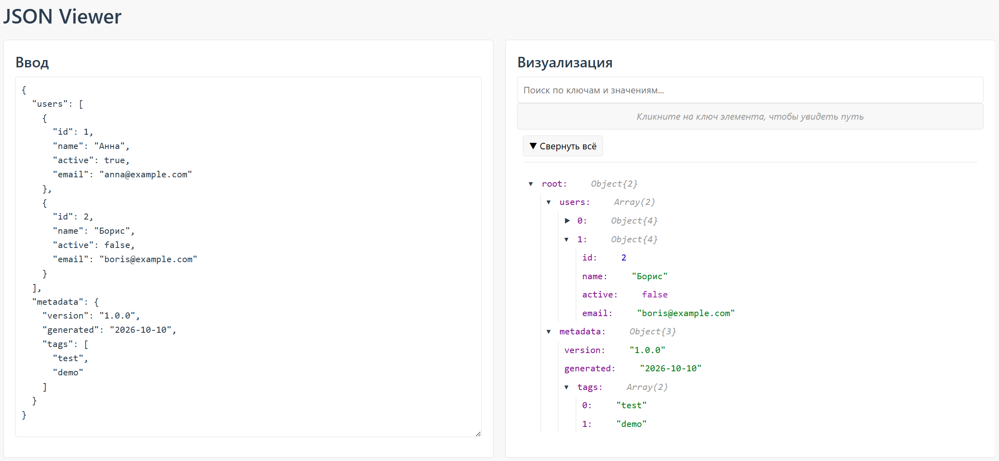

# JSON Viewer

Интерактивный веб-инструмент для визуализации и анализа JSON: дерево с поиском, копированием путей и подсветкой синтаксиса.



## Возможности

- **Интерактивное дерево** — сворачивание и разворачивание узлов
- **Живой поиск** — подсветка совпадений по ключам и значениям
- **Копирование путей** — клик на ключ копирует путь вида `root.users[0].name`
- **Подсветка типов** — строки, числа, boolean и `null` разными цветами
- **Мгновенная валидация** — ошибки парсинга видны сразу
- **Адаптивный дизайн** — работает на телефонах и десктопе
- **Доступность** — навигация с клавиатуры, поддержка скринридеров

## Технологии

- [React 18](https://react.dev/) — UI-библиотека
- [TypeScript](https://www.typescriptlang.org/) — типизация
- [Vite](https://vitejs.dev/) — сборщик
- [ESLint](https://eslint.org/) — линтер

## Быстрый старт

### Требования

- [Node.js](https://nodejs.org/) версии 18 или выше
- npm (идёт вместе с Node.js)

### Установка

```bash
# Клонировать репозиторий
git clone https://github.com/kater-g/json-viewer.git
cd json-viewer

# Установить зависимости
npm install

# Запустить дев-сервер
npm run dev
```

## Скрипты

| Команда | Описание |
|---|---|
| `npm run dev` | Запуск дев-сервера |
| `npm run build` | Сборка продакшн-версии |
| `npm run lint` | Проверка линтером |
| `npm run lint:fix` | Автоисправление ошибок |